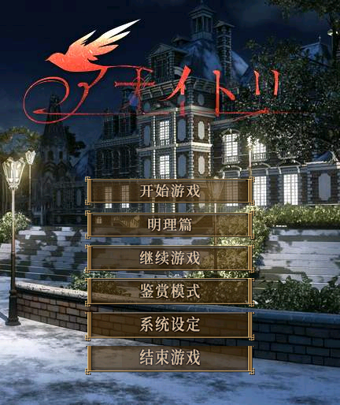

# アオイトリ / AOI TORI (REDMI Watch 5 移植版)

Purple software《アオイトリ / AOI TORI》的 **REDMI Watch 5**（`432×514` Xiaomi Vela QuickApp）R18 完整版非官方同人移植工程。

> **测试环境说明**：本版所有 UI、音频、CG、立绘、OP 与自动播放逻辑均已在官方小米 Vela 5.0 REDMI Watch 5 模拟器上实机运行验证（`physicalDeviceTested: false`，尚未连接真机手表硬件测试）。已针对 Watch 5 物理屏幕大 R 角将四角按钮与提示条进一步向内收紧（`44px` 左右边距 / `14px` 上下内距）。

## 标题界面展示（3 种推进阶段）

标题背景、主题曲与按键数量随剧情推进自动变化，并在解锁多张标题 CG 后支持在「系统设定 → 标题背景 CG」中自由切换（主题曲同步切换）：

| Stage 1 · 初夜洋馆 (`title01`) | Stage 2 · 雪庭昼景 (`title02`) | Stage 3 · 真相明里 (`title03`) |
| :---: | :---: | :---: |
|  |  |  |
| 默认标题 · `bgm36`（月下）· 居中竖排 | 序章结束后解锁 · `bgm36` · 居中竖排 | 三线通关后解锁`明里篇` · `bgm33`（青鸟）· 左对齐避让人物 |

---

## 核心特性

- **包体与规格**：
  - 包名：`com.antigravity.aoitori.rw5` · 应用名：`アオイトリ`（`v1.0.0`，`designWidth: 432`）
  - 签名包体积：`24,747,409 B`（`< 25,000,000 B` 上限，余量 `252,591 B`），ZIP 条目：`3,175`（`<= 4,100`）
  - 编译器：`aiot-toolkit 1.1.0`
- **完整中文剧本（仅 R18 版）**：
  - 去除全年龄/R18 剧本切换，整合为完整 R18 流程：共 `100` 个剧情节点、`184` 个剧本分片、`1,684` 张 BG/CG（鉴赏模式 `117` 组完整比例渲染，不裁切人物）与 `950` 个角色立绘资源（保留 `st-` / `up-` / square 原始比例，按角色槽位 `cid` 幂等切换与双/多立绘排版）。
- **字体与对话框**：
  - 内置 `aoitori-text.otf`（`1,352,968 B`，`3,160` 个字符验证 `0` 缺字），还原原作羽毛主题对话框，正文左上第一行起排。
- **OP 动画与音乐系统**：
  - 修复 CMVS `JBPD` 宏块解压解码后重制为 `417` 帧干净画质（`288×162`，`3.43 fps`，时长 `121,458 ms`），支持点击画面直接跳过 OP 并切回标题曲；去除顶部秒数计时显示。
  - 音乐鉴赏曲目仅在鉴赏二级菜单内播放，返回「鉴赏模式」时自动恢复标题曲（若所选曲目与当前标题曲一致则无缝续播，不中断重头）。
- **自动播放与手势体验**：
  - 阅读菜单内提供 `自动播放：开启 / 关闭` 与 `自动速度：慢速 (2.6s) / 标准 (1.5s) / 快速 (0.8s)` 三档（超过 `60` 字每字额外 `+55ms`，上限 `+5s`；自动模式下始终以 `30 ms/字` 逐字显示，不影响手动模式的 `即时 / 逐字` 设置）。
  - 遇到分支选项、打开菜单/存读档/设定、切入后台及正文拖动/惯性滚动期间暂停，返回正文或滚动停止后重新计时；手动点击推进或打开菜单操作均保留自动状态；点击 `上一句`、结局、报错、返回标题或退出应用则重置关闭自动播放（不写入存档与通关记录）。

---

## 本地构建与校验

### 环境要求
- Node.js（含内置 `node:test`）与 Python 3
- 小米 Vela `aiot-toolkit 1.1.0`（构建签名 RPK）及 Watch 5 官方模拟器（`tools/emulator-server.cjs`）

### 常用命令

```bash
# 运行核心引擎、音频状态机、立绘与自动阅读单元测试
npm test

# 构建并签名 REDMI Watch 5 .rpk / .bin 安装包
npm run build

# 校验 ZIP CRC、双层签名、文件摘要、缺字与资源完整性
npm run audit

# 启动 Watch 5 模拟器控制服务 (http://127.0.0.1:43208)
node tools/emulator-server.cjs
```

## 安装使用

可前往本仓库 [Releases](../../releases) 页面下载已签名构建产物 `com.antigravity.aoitori.rw5.debug.1.0.0.rpk`（或 `.bin`），并核对 `SHA256SUMS.txt` 后，通过官方 Vela 工具链或 Watch 5 开发者调试环境安装至设备。
